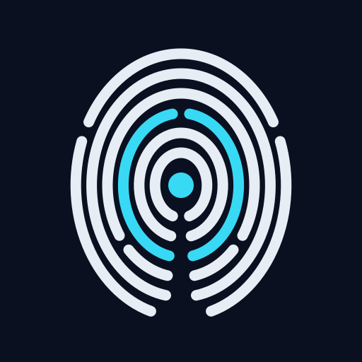

<p align="center"></p>

# Dactyloscope

*Dactyloscopy: the forensic science of fingerprint identification.*

Dactyloscope is a self-hosted browser fingerprint inspection service. Point any
browser at it (Chrome, Firefox, a headless build, an automation framework, an
antidetect browser) and it tells you what a bot-detection or anti-fraud vendor
would see, at every layer:

- **TLS:** the decoded ClientHello, JA3 / JA3n / JA4, and a field-by-field diff
  against real-browser reference captures
- **HTTP/2:** the connection preface (SETTINGS, WINDOW_UPDATE, PRIORITY,
  pseudo-header order) and the Akamai fingerprint
- **HTTP:** header order and values against what the claimed browser actually sends
- **JavaScript:** about 150 in-page probes covering canvas, WebGL, audio, fonts,
  workers, iframes, automation globals, patched natives, and JS-engine and API
  mismatches

## Run it

Requirements: Python 3.11+ and the `openssl` CLI.

```bash
python3 -m venv .venv && .venv/bin/pip install -r requirements.txt
.venv/bin/python -m dactyloscope serve     # https://0.0.0.0:8443  http://0.0.0.0:8080
```

Then open <https://127.0.0.1:8443/> and accept the self-signed certificate.

Environment variables and flags: `DACTYLOSCOPE_HOST`, `DACTYLOSCOPE_TLS_PORT`
(8443), `DACTYLOSCOPE_PLAIN_PORT` (8080, `0` disables it), `DACTYLOSCOPE_DATA`,
`DACTYLOSCOPE_CERTS`, `--captures DIR` (extra reference captures),
`--san HOST` (extra certificate names), `--keep N`.

On the Internet, run with `--public`: client IPs are not stored, and listing or
deleting reports and writing baselines need `Authorization: Bearer $DACTYLOSCOPE_ADMIN_TOKEN`.

On first start it mints a local CA and a leaf certificate under `data/certs/`.
The CA is also served at `/ca.pem` on both ports.

### Docker

```bash
docker build -t dactyloscope .
docker run --rm -p 8443:8443 -p 8080:8080 -v dactyloscope-data:/app/data dactyloscope
```

## Inspect a browser

* **Interactively:** open `https://<host>:8443/`. The page runs the probes and
  opens the report. `?tag=name` labels the run, and `?noredirect=1` stays on
  the probe page.
* **Any WebDriver browser** (this is what CI should do):

  ```bash
  python -m dactyloscope check --webdriver http://127.0.0.1:7000 \
      --server https://127.0.0.1:8443 --tag ci --fail-on warn
  ```

  `check` prints the text summary (or `--json`). It exits 1 when there are
  findings at the `--fail-on` level, and 3 when the probes did not finish. The
  partial report is still printed, so you can see which section stalled. A
  browser that ignores `--ignore-certificate-errors` but uses BoringSSL or
  OpenSSL can trust the CA through `SSL_CERT_FILE=data/certs/ca.pem`.
* **Real Chrome / Firefox for a baseline:**

  ```bash
  google-chrome --headless=new --ignore-certificate-errors --user-data-dir=/tmp/p \
      'https://127.0.0.1:8443/?tag=chrome&noredirect=1'
  python -m dactyloscope firefox-profile /tmp/ffprof      # writes cert_override.txt
  firefox --headless --profile /tmp/ffprof 'https://127.0.0.1:8443/?tag=firefox'
  ```

  Don't use `--dump-dom` / `--virtual-time-budget` with Chrome. Chrome exits
  before the asynchronous probes have posted their results.

## Read the result

Every UI page has a JSON twin. Any report URL also answers `Accept: text/plain`
(or `?format=text`) with a short summary meant for a person or a language model.

```bash
curl -sk 'https://HOST:8443/api/report/latest?tag=ci&wait=60' -H 'accept: text/plain'
curl -sk  https://HOST:8443/api/report/<id>/findings?min=warn
curl -sk  https://HOST:8443/api/whoami                   # network layer only, no browser
curl -sk 'https://HOST:8443/api/compare?a=latest&b=baseline:chrome-152-headless'
curl -sk -X POST 'https://HOST:8443/api/baseline/chrome-152-headless?report=<id>'
```

`whoami` is useful on its own: run it from `curl`, `requests` or `httpx`, or
from a TLS-impersonation library, to see how far the client is from the browser
it claims to be.

`/docs` in the UI lists all endpoints, the report schema and the finding-id
conventions (`tls.*`, `h2.*`, `http.*`, `nav.*`, `engine.*`, `apis.*`,
`canvas.*`, `webgl.*`, `audio.*`, `fonts.*`, `auto.*`, `integrity.*`,
`worker.*`, `iframe.*`, `media.*`, `timing.*`).

Scoring is 20 per `fail` plus 6 per `warn`, capped at 100. The verdict is
`clean` below 10, `suspicious` below 40, and `automated` otherwise.

- A `fail` is something a detector can act on by itself: engine mismatch,
  canvas noise, hooked natives, automation globals, an unknown TLS shape.
- A `warn` is a deviation from what the claimed browser does.
- An `info` is context.

## Reference data

TLS and HTTP/2 shapes come from `captures/*.json`: Chrome 145–152 and
Firefox 154, captured with `tools/capture_*.py` (see
[`captures/README.md`](captures/README.md)). Header expectations for Chrome 152
and Firefox 154 are embedded in `known.py`.

The comparison ignores what varies per connection: GREASE values, extension
order (Chrome permutes it), padding, SNI (absent for IP literals) and
pre_shared_key (session resumption).

What real headless browsers score on a Linux box, for calibration:

| browser | score | what trips |
|---|---|---|
| Chrome 152 `--headless=new` | 52 | `HeadlessChrome` UA, SwiftShader WebGL, no fine pointer / hover |
| Firefox 154 `--headless` | 12 | no fine pointer / hover |
| A non-Chromium engine spoofing a Chrome 147 profile | 100 | JS-engine tells, canvas/audio noise, hooked natives, `webdriver*` globals, worker mismatch, missing Chrome APIs |

Headless captures are useful for regressions. A baseline for "does this pass as
Chrome" should come from a headed browser on the OS the profile claims.

## Scope

Dactyloscope is a measurement tool. It is meant for testing your own browsers
and automation stacks, studying how detection works, and building clients that
render the web correctly. It does not bypass anything by itself.
